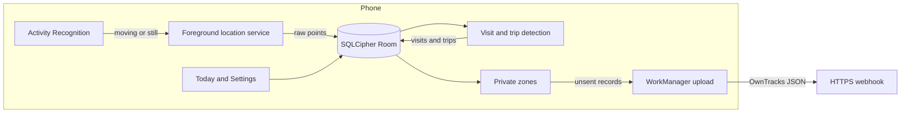

# Trail

Trail is a private, single-user Android location diary. It keeps a quiet record of where the phone goes so a personal diary assistant does not miss a short outing, such as a dog walk, between scheduled check-ins.

It is an OwnTracks-style tracker for one person. There is no account, no analytics SDK, and no ads. Points stay on the phone until a WorkManager job posts a batch to a webhook URL that person configures.

The rest of this git repository is an unrelated Ruby exercise. Trail lives entirely under `trail/`, except for two GitHub files that the platform only reads at the repository root: `.github/workflows/trail.yml` and `.github/CODEOWNERS`.

## Architecture



| Module | Role |
| --- | --- |
| `:core` | Pure JVM. Detection, zones, batching, retry, OwnTracks JSON, the webhook client, GPX and JSON export. |
| `:app` | Android UI, foreground service, encrypted Room, encrypted preferences, WorkManager. |

Sampling follows activity recognition:

- Moving (walking, running, cycling, driving): about every 20 seconds, high accuracy. The request window is 15–30 seconds.
- Still: about every 8 minutes, balanced power. The request window is 5–10 minutes.
- If activity recognition is denied, Trail stays on the moving rate so a walk is not sampled as if the phone were on a table.

A stay is a run of points that remain within about 100 meters of the first point in that run for at least 5 minutes. Movement between stays is a trip. A gap longer than 30 minutes splits a trip so a paused phone does not invent a journey across the hole. The visit at the end of the recorded stream stays open until a later point shows a departure, so a leave transition is not uploaded early. Mode is the majority of walk, bike, or drive labels, otherwise speed: under 2.2 m/s walk, under 8 m/s bike, otherwise drive.

Raw points are stored and uploaded even when they never become a 5-minute stay. That is how a short dog walk still shows up.

## Setup

Requirements:

- JDK 21 (the project emits Java 17 bytecode)
- Android SDK command-line tools, platform `platforms;android-37.2`, and build-tools `37.0.0`
- A device or emulator with Google Play services (fused location and activity recognition)

```bash
export ANDROID_HOME="$HOME/android-sdk"
printf 'sdk.dir=%s\n' "$ANDROID_HOME" > trail/local.properties
cd trail
./gradlew :app:assembleDebug :core:test :app:testDebugUnitTest
```

`local.properties` is gitignored. Do not commit it.

The debug APK is `trail/app/build/outputs/apk/debug/app-debug.apk`. Install it with `adb install -r` that file. Sideloading, location, and battery steps are in [docs/RELEASE.md](docs/RELEASE.md).

Release builds are minified with R8 and are not debuggable. Signing is applied only when `TRAIL_KEYSTORE_FILE` is set. Secret names, never values, are listed in [docs/RELEASE.md](docs/RELEASE.md).

## Webhook

In Settings, enter an `https://` URL and the exact `Authorization` header value the server expects (often `Bearer …`). Both are stored in EncryptedSharedPreferences and are not written to logcat. Trail rejects `http://` URLs and rejects tokens placed in the URL user-info.

The body is one JSON object, because a bare array cannot carry batch metadata. `messages` holds OwnTracks-compatible objects. Coordinates below are synthetic.

```json
{
  "trail_meta": {
    "device_id": "device-1",
    "batch_id": "2f0c1c0e-7b0a-4c1e-9c2a-0d5e6f708192",
    "app_version": "1.0.0"
  },
  "messages": [
    {
      "_type": "location",
      "lat": 37.5,
      "lon": -122.2,
      "acc": 8,
      "alt": 10,
      "vel": 4,
      "cog": 20,
      "tst": 1700000111,
      "batt": 70,
      "conn": "w",
      "tid": "KV"
    },
    {
      "_type": "transition",
      "event": "enter",
      "lat": 37.5,
      "lon": -122.2,
      "acc": 50,
      "tst": 1700000000,
      "tid": "KV",
      "desc": "visit"
    }
  ]
}
```

`tst` is Unix seconds. `vel` is kilometers per hour. `cog` is course in degrees. `conn` is `w` (wifi or ethernet), `m` (mobile), or `o`. `tid` is a two-character tracker id, default `KV`.

Uploads run about once an hour. Settings can move that between 15 and 120 minutes. **Upload now** sends immediately and skips the Wi-Fi-only and low-battery deferrals. It still requires HTTPS. A record is marked sent only after a 2xx response. The same batch id is reused on retry so the receiver can ignore a duplicate. Records are also deduped on kind plus `tst`. Backoff starts at 30 seconds and doubles up to one hour. 408, 429, 5xx, and a missing HTTP status are retried. Other 4xx responses are permanent until the settings change.

An optional certificate pin (`sha256/` plus the base64 SHA-256 of the server certificate) is documented in [docs/SECURITY.md](docs/SECURITY.md). Leave it blank unless you pin on purpose.

## Battery and privacy trade-offs

- Moving at ~20 seconds catches a short walk. It costs more battery than a 5-minute still interval. Still mode exists so a phone on a desk is not polled like a drive.
- A foreground service with a low-importance notification is what keeps updates alive after the app leaves the screen. Android can still defer work in Doze. Allow unrestricted battery use if walks go missing. See [docs/RELEASE.md](docs/RELEASE.md).
- Background location (“Allow all the time”) is requested on its own screen, after an explanation, not in the first permission prompt.
- Private zones change the upload only. **Drop** omits points inside the radius. **Coarsen** snaps them to a ~1 km grid and raises the reported accuracy. The on-device diary and GPX/JSON export stay full precision. Dropped points are marked suppressed so they are not retried.
- Default retention is 90 days. 30, 365, and forever are available. A daily job deletes points, visits, and trips older than the cutoff.
- Pause stops the foreground service. Choose 1, 2, 4, or 8 hours, or until you tap Resume. Wipe removes points, visits, trips, zones, and sync state. The webhook settings stay until you tap Forget webhook.
- Map tiles come from OpenStreetMap through osmdroid. That is a network request for map pictures, separate from the webhook. The map is not loaded when there is no route today. Play services location also talks to Google. Details are in [docs/PRIVACY.md](docs/PRIVACY.md).

## Tests

```bash
cd trail
./gradlew :core:test :app:testDebugUnitTest :app:lintDebug detekt :app:assembleDebug
```

`:core:test` covers visit and trip detection, private zones, batching, OwnTracks JSON, retry and idempotency, and the webhook client against MockWebServer. `:app:testDebugUnitTest` covers Room DAOs and visit storage with Robolectric, and drives `UploadWorker` against MockWebServer.

Robolectric cannot load SQLCipher’s native library. Those DAO tests open an in-memory Room database without encryption. The production open path is `DatabaseFactory`, which always loads SQLCipher with a Keystore-held passphrase. That path was not executed in unit tests, and this environment has no phone or emulator, so fused location, the foreground service, osmdroid, and the encrypted database were not run on a device.

## Further reading

- [docs/SECURITY.md](docs/SECURITY.md)
- [docs/PRIVACY.md](docs/PRIVACY.md)
- [docs/RELEASE.md](docs/RELEASE.md)
- [docs/ROADMAP.md](docs/ROADMAP.md)
